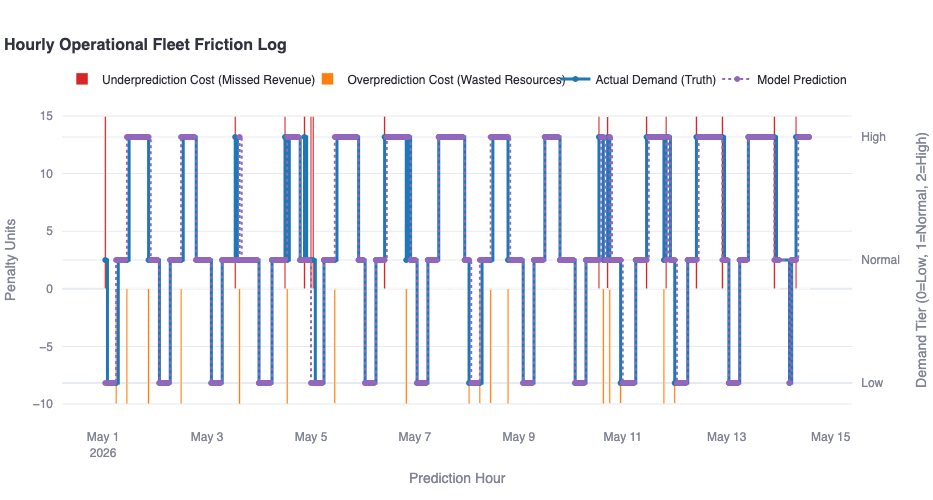
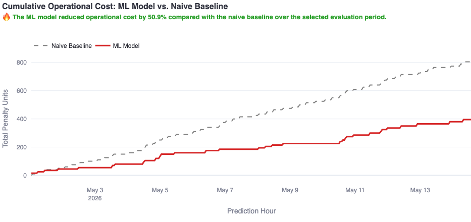

# 🚲 Citi Bike Ride Demand Prediction
### End-to-End Data Engineering & MLOps Platform

An end-to-end data engineering and machine learning project designed to process Citi Bike trip data, build ride demand prediction workflows, and support operational analytics.

The project combines **Apache Airflow, Python, Apache Iceberg, FastAPI, Streamlit, Docker, and machine learning** into a unified data processing and prediction platform.

---

## 📌 Project Overview

Urban bike-sharing systems generate large volumes of trip data. Understanding ride demand can help operators improve bike availability, identify usage patterns, and support better resource allocation.

This project implements a data engineering and machine learning architecture to:

- Ingest and process Citi Bike trip data.
- Clean and transform raw datasets.
- Build Bronze, Silver, and Gold data layers.
- Engineer features for ride demand prediction.
- Train and evaluate machine learning models.
- Generate batch predictions.
- Support operational analytics through an interactive dashboard.
- Automate pipeline execution using Apache Airflow.

---

## 🛠️ Technology Stack

| Category | Technologies |
|---|---|
| Programming | Python, SQL, Bash |
| Data Engineering | Apache Airflow, Apache Iceberg |
| Architecture | Medallion Architecture, Write-Audit-Publish (WAP) |
| Machine Learning | Python-based model training, feature engineering, batch scoring |
| Databases | PostgreSQL, DuckDB |
| Backend | FastAPI |
| Dashboard | Streamlit |
| Infrastructure | Docker, Docker Compose |
| Version Control | Git, GitHub |

---

## 🏗️ System Architecture

The platform follows a **Medallion Architecture** with three primary data processing layers.

### 1. Bronze Layer — Raw Data Ingestion
- Downloads and ingests Citi Bike trip data.
- Preserves raw records for downstream processing.
- Supports ingestion and backfill workflows.

### 2. Silver Layer — Data Cleaning and Transformation
- Processes raw trip records.
- Prepares structured datasets for analytics.
- Uses Write-Audit-Publish workflows to support data quality.

### 3. Gold Layer — Analytics and Machine Learning
- Produces curated datasets for analysis.
- Generates machine learning features.
- Supports ride demand modeling and batch scoring.

### Machine Learning Pipeline

The machine learning workflow includes:

1. Feature engineering
2. Model training
3. Model evaluation
4. Batch demand prediction
5. Prediction synchronization

### Serving and Visualization

**FastAPI** provides backend API functionality, while **Streamlit** supports interactive analytics and operational monitoring.

Apache Airflow coordinates the data processing and machine learning workflows.

---

## 📂 Project Structure

```text
Ride-Demand-Prediction-GitHub/
│
├── airflow-image/
│   ├── Dockerfile
│   └── requirements.txt
│
├── config/
│   ├── local.yml
│   └── top50_station_ids.txt
│
├── dags/
│   ├── 1b_bronze_ingestion_citibike.py
│   ├── 2b_silver_wap_purification_citibike.py
│   ├── 3c_gold_citibike.py
│   └── 4_ml_batch_demand_score.py
│
├── jobs/
│   ├── download_citibike_data.py
│   ├── bronze_ingest_citibike.py
│   ├── silver_wap_citibike.py
│   ├── gold_citibike.py
│   ├── ml_features_citibike.py
│   ├── train_citibike_model.py
│   └── score_and_sync_citibike.py
│
├── fastapi/
│   ├── Dockerfile
│   └── main.py
│
├── streamlit/
│   ├── app.py
│   ├── requirements.txt
│   └── pages/
│       └── 1_CitiBike_Dashboard.py
│
├── docker-compose.yaml
├── .env.example
├── .gitignore
├── init.sh
├── demand_log.png
├── operational_cost.png
└── README.md
```

*The structure above highlights the main Citi Bike components. The repository also contains supporting pipeline scripts and utilities.*

---

## 📊 Dashboard and Analytics

The Streamlit application provides a foundation for visualizing Citi Bike data and monitoring demand-related analytics.

The repository also includes the following analytical visualizations.

### Demand Analysis



### Operational Cost Analysis



---

## ⚙️ Getting Started

### Prerequisites

- Python
- Docker Desktop
- Docker Compose
- Git

### 1. Clone the Repository

```bash
git clone https://github.com/Adi0528/CitiBike-Ride-Demand-Prediction.git
cd CitiBike-Ride-Demand-Prediction
```

### 2. Configure Environment Variables

Create a local environment file from the provided template.

```bash
cp .env.example .env
```

Replace the placeholder values with unique credentials.

Never commit the `.env` file or real authentication secrets.

### 3. Start the Services

```bash
docker compose up -d --build
```

The services require their dependencies and configuration to be available.

### 4. Access the Applications

| Application | Local URL |
|---|---|
| Apache Airflow | http://localhost:8080 |
| Streamlit Dashboard | http://localhost:8501 |
| FastAPI Documentation | http://localhost:8000/docs |
| Jupyter Notebook | http://localhost:8888 |

### 5. Process Data

The repository includes scripts for downloading, ingesting, transforming, and preparing Citi Bike trip data.

For example:

```bash
bash run_all_months.sh
```

### 6. Model Training and Prediction

The machine learning scripts are located in the `jobs/` directory.

Important Citi Bike scripts include:

- `ml_features_citibike.py`
- `train_citibike_model.py`
- `score_and_sync_citibike.py`

These support feature preparation, model training, and demand prediction workflows.

---

## 🔐 Security

- Local environment variables are used for credentials.
- `.env.example` provides configuration placeholders.
- Real secrets should never be committed.
- Generated datasets, model artifacts, and logs are excluded from version control where configured.
- Use unique credentials before running the services.

---

## 📈 Potential Applications

This project demonstrates workflows relevant to:

- Bike-sharing demand forecasting
- Urban mobility analytics
- Data pipeline orchestration
- Machine learning operations
- Operational decision support
- Data engineering and analytics

---

## 📌 Project Status

The repository contains the source code, pipeline definitions, machine learning scripts, API components, and dashboard implementation.

A fresh end-to-end execution and deployment verification have not been performed as part of the GitHub publication process. No specific prediction accuracy or production performance is claimed here.

---

## 👨‍💻 Author

**Aditya P. More**

Master of Science in Data Science  
University at Buffalo, The State University of New York

**GitHub:** [Adi0528](https://github.com/Adi0528)

---

## ⭐ About This Project

This project showcases the integration of data engineering, machine learning, workflow orchestration, backend development, and dashboard visualization into a single analytics platform.
